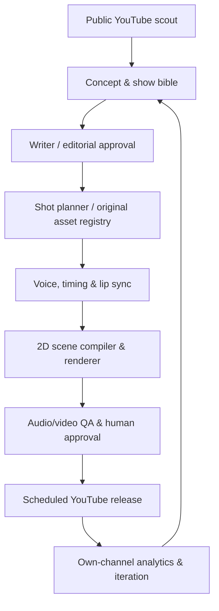

# AI-Assisted Animation Production Architecture

## Design goals

1. Produce **original, character-consistent 2D animation** from scripts using the same underlying code, with multiple independent franchises.
2. Use AI coding agents (Codex, Claude Code, etc.) to build/test the modules; use a **durable runtime workflow** (LangGraph plus deterministic workers) to operate them. These are different roles.
3. Generate frame-accurate, versioned specifications. Re-render from the exact same inputs rather than accepting non-reproducible video output.
4. Preserve legal provenance, human creative control, and YouTube compliance.
5. Start with one worker and one show before adding complexity or speculative infrastructure.

## Architecture, at a glance



### Recommended stack

| Concern | Recommended component | Why / implementation note |
| --- | --- | --- |
| Orchestrator | Python LangGraph with persisted state | Conditional retries, human review interrupts, bounded revision loops |
| API | FastAPI + Pydantic v2 | Typed episode jobs, API and validation contracts |
| Persistence | Postgres | Channels, bibles, episode versions, approvals, metrics |
| Work execution | Redis-backed durable queue + Python/Node workers | Render/TTS jobs survive restart; explicit retry and idempotency |
| Media objects | S3-compatible bucket, versioned + SHA-256 | Art source, audio, intermediate assets, render and manifests |
| Art | Original layered SVG/PNG + JSON rig manifests | Fixed geometry, transparent layers, pose libraries, asset reuse |
| 2D animation | React + SVG transforms inside Remotion | Frame-controlled, parameterized scenes, deterministic render |
| Sound | Fish Audio for permitted/licensed TTS; own/stock SFX; FFmpeg mix | Distinct consented voices and reproducible mastering |
| Speech timing | Deepgram word-level timestamps; Rhubarb Lip Sync visemes | Subtitle and mouth-cue alignment; verify accuracy |
| Output | H.264 MP4 / AAC, horizontal and vertical variants | Stable codecs, publishable deliverables |
| Review | Minimal dashboard with video, shot timeline, diffs and approval buttons | Human acceptance and stage-specific resubmission |
| Publication | YouTube Data API OAuth on approved account | Scheduled/draft uploads after human publication gate |
| Measurement | YouTube public Data API + authenticated Analytics API for owned channels | Separate public competitor stats from private performance data |

References: Remotion render and Docker docs https://www.remotion.dev/docs/render and https://www.remotion.dev/docs/docker ; Fish Audio official SDK https://github.com/fishaudio/fish-audio-python ; Deepgram timestamps https://developers.deepgram.com/docs/pre-recorded-audio ; Rhubarb source https://github.com/DanielSWolf/rhubarb-lip-sync ; LangGraph human review https://langchain-ai.github.io/langgraph/how-tos/human_in_the_loop/breakpoints/ . Review Remotion's **commercial license** requirements before production: https://www.remotion.dev/docs/terms .

## Core rule: scenes are a small executable grammar

Do **not** ask a general-purpose model to invent every frame. Agents propose a limited scene grammar, and a deterministic compiler maps it to renderable properties.

### Character/asset contract

- Every `character_id` maps to an original design sheet and canonical rig manifest with stable IDs: body parts, anchor points, mouth shapes, eyes, hands and silhouettes.
- Each rig has invariant proportions and an allowed 0–1 normalized range for movement, blink, talk, body bounce and expression.
- Animations are composed from reusable approved primitives: `idle`, `blink`, `talk`, `glance`, `head_tilt`, `walk`, `point`, `pick_up`, `drop`, `shake`, `squash`, `jump`, `recoil`, `hold`.
- Each shot includes `background_id`, props, character placement, action keyframes, dialogue timing, camera transform, sound effects, and caption data.
- The writer can propose a new primitive, but a renderer-capability validator must reject unknown actions instead of silently ignoring them.
- Store the original layered files, asset author/creator, usage terms, source hash, and approvals. Human review is mandatory for new character identities.

### Timing and rendering

At 30 fps, `start_frame = 270` means 9.0s into the episode. Use integer frame math throughout. Voice lines have absolute start frames and verified durations in frames after TTS generation; `Rhubarb` visemes are re-timed into character mouth sprites. Retain timestamps at sample accuracy where available and round only for rendering.

The scene compiler must guarantee:

- Contiguous shot range without accidental gaps/overlaps (unless deliberate transitions specify overlap).
- Every visible layer references a registered asset with matching show namespace and approved rights.
- Dialogue and SFX do not run out of their permitted shot range.
- Camera, action, and animation parameters match the renderer's enums and bounds.
- The canonical `episode.schema.json` validates before any expensive generation; cross-field and cross-reference checks run separately.

## Stateful production workflow

```text
DISCOVERED
  -> CONCEPT_REVIEW
  -> CANON_LOCKED
  -> BEAT_SHEET_REVIEW
  -> SCRIPT_APPROVED
  -> SHOTPLAN_APPROVED
  -> ASSETS_APPROVED
  -> AUDIO_APPROVED
  -> ANIMATIC_APPROVED
  -> RENDER_COMPLETE
  -> AUTOMATED_QA_PASS
  -> HUMAN_FINAL_APPROVAL
  -> UPLOAD_DRAFTED
  -> RELEASED
  -> OBSERVING_7D_28D
  -> ARCHIVED
```

At each human gate: `approved`, `changes_requested`, or `rejected`. An approval must record `reviewer_id`, version hash, timestamp, and free-text feedback; editing the underlying content **invalidates** downstream approvals. Retries must be bounded (e.g., up to three automatic attempts per stage), with deterministic failure codes and an exception queue. Never publish on mere successful render completion.

### Creative agent roles, with strict boundaries

| Role | Reads | Writes | Non-negotiable boundary |
| --- | --- | --- | --- |
| Scout | Public metrics and source metadata | Evidence-backed hypotheses | Cannot claim competitor retention or revenue |
| Development editor | Approved franchise direction | Concept score and episode brief | Cannot silently switch target audience or show |
| Lore keeper | Canonical show bible | Continuity report + version changes | Cannot rewrite accepted canon without approval |
| Writers' room | Brief, bible, accepted lore | Logline, beats, scripted dialogue | Must create original material; no source show scripts |
| Comedy/story editor | Script, pacing target | Structured revisions + critique | May veto generic joke templates, flags weak premise |
| Storyboard planner | Approved script, asset library | Shots, compositions, actions | Only supported scene grammar |
| Art/rig builder | Approved design spec | Layered SVGs and rig test poses | No unlicensed styles, characters, or likenesses |
| Voice director | Approved dialogue and consented voices | Line-level TTS and direction notes | No imitation of identifiable third-party voices |
| Render worker | Validated specification and approved assets | MP4, thumbnails, hashes and logs | Deterministic output; no creative improvisation |
| QC agent | All media and metadata | Measured defects and risk findings | Can block; never auto-clear IP concerns alone |
| Human editor | Proposed episode, video, rights | Approval / revision direction | Final accountable editorial and release gate |
| Analytics agent | Public snapshots + authorized Studio metrics | Cohort analysis and next experiments | No post-hoc fabricated causal explanations |

## Minimal Postgres logical model

```text
studios(id, name)
shows(id, studio_id, title, audience, status, style_version, canon_version)
characters(id, show_id, canonical_name, rig_asset_id, approved_at)
assets(id, show_id, kind, sha256, storage_uri, license_class, rights_ref, approved_at)
episodes(id, show_id, episode_number, title, stage, latest_version_id)
episode_versions(id, episode_id, schema_version, json_sha256, json_uri, created_at)
approvals(id, episode_version_id, gate, reviewer_id, decision, reason, created_at)
jobs(id, show_id, episode_version_id, stage, input_hash, status, attempts, result_uri, error_code)
publish_records(id, episode_version_id, platform, external_video_id, status, released_at)
video_snapshots(id, external_video_id, observed_at, views, likes, comments, metric_version)
owned_analytics(id, channel_id, video_id, period_start, period_end, metric, value, source)
experiments(id, show_id, hypothesis, variant, preregistered_metric, decision)
```

Implement constraints: unique `(episode_version_id, stage, input_hash)` job key; unique `(external_video_id, observed_at)` per data source; timestamps UTC; tenant/show namespace on every record. Public snapshots and private owner analytics must be in separate tables and access scopes.

## Media object paths and immutability

```text
s3://studio-assets/shows/{show_id}/bibles/{canon_version}.json
s3://studio-assets/shows/{show_id}/characters/{character_id}/rig/{sha256}.json
s3://studio-assets/episodes/{episode_id}/versions/{version_id}/episode.json
s3://studio-assets/episodes/{episode_id}/versions/{version_id}/audio/{line_id}.wav
s3://studio-assets/episodes/{episode_id}/versions/{version_id}/visemes/{line_id}.json
s3://studio-assets/episodes/{episode_id}/versions/{version_id}/renders/master.mp4
s3://studio-assets/episodes/{episode_id}/versions/{version_id}/qa/report.json
```

Use immutable object versioning for source snapshots and content-addressable asset IDs. Enforce explicit retention/deletion schedules for third-party public API data based on YouTube's API policy; do not expose object storage URLs in public video metadata.

## Generator adapter contracts

- **LLM adapters**: accept JSON input, return JSON or `ParseError`; validate, then repair at most two times. Log model identifier, prompt version, task inputs hash, seed if supported, and estimated cost; do not log credentials or unnecessary personal data.
- **TTS adapter**: input `{text, voice_id, pace, emotion, language}`; output `{wav_uri, sample_rate, duration_ms, rights_ref}`. Ensure voices are licensed/consented. Fish Audio is a candidate, not a dependency mandate.
- **Transcription/word timing adapter**: input WAV and expected text; output tokens with `{start_ms,end_ms,word,confidence}`. Reject substantial mismatch.
- **Viseme adapter**: input WAV; output ordered mouth cues; map Rhubarb A–H to rig pose IDs. Align to word timing and never extrapolate beyond line duration.
- **Renderer adapter**: input immutable `episode_version_id`; output MP4, render log, checksum, codec probe; render the same version without agent creativity.
- **Publisher adapter**: draft upload first; only a human-approved release transitions to public. Preserve YouTube's authorization scopes and quotas.

## Human editorial checkpoints

1. **Greenlight:** originality, audience, premise and likely production feasibility.
2. **Script:** story logic, fresh comedic/tension beats, authentic tonal voice, no protected imitation.
3. **Storyboard/assets:** actual rig feasibility, continuity, distinct visual direction.
4. **Audio:** voices, pronunciation, performance, cleared music and SFX.
5. **Final:** A/V QC, thumbnail truthfulness, metadata, subtitles, age/ad suitability, AI disclosure, rights.

For the first 20 releases, **review every item**. Partial auto-approval later may be considered only for objective checks (schema, bitrate, missing files, captions), never editorial originality or release authorization.

## Automated QA matrix

| Check | Objective condition | Result |
| --- | --- | --- |
| Contract validity | Episode passes JSON Schema and referential validation | Block on error |
| Time coverage | Frame ranges contiguous; no unintended blank segments | Block on error |
| Media references | Every used file exists and checksum matches manifest | Block on error |
| Ownership | `rights_ref` on every asset, voice, music/SFX source | Block missing/unknown |
| Provenance | No competitor assets imported; protected-source similarity flagged | Human review needed |
| Dialogue | Spoken text matches approved script within review tolerance | Flag mismatch |
| Lip sync | No visemes outside line boundaries; spot-check selected frames | Auto + visual QA |
| Audio | No clipping, unplanned silence, or unreadable mix | Block errors, manual aesthetic pass |
| Video | Expected dimensions, codec, FPS, length, no dropped corrupt frames | Block error |
| Captions | Timed lines, max duration/line length thresholds, no missing dialogue | Flag / block |
| Channel policy | Age rating, music rights, disclosure, titles, metadata | Mandatory manual signoff |
| Original story | Material difference from prior episodes, meaningful new narrative | Editorial score, never sole semantic threshold |

Test with unit contract fixtures, render golden images, audio fixture files, and two complete pilots. Run render hashes only within a pinned runtime/browser/font/codec environment; encoding can vary across hardware and versions even when frames match.

## Deployment and scaling

**Stage 1 — single-node:** Docker Compose: Postgres, Redis, FastAPI, LangGraph worker, Node render worker, minimal storage. CPU rendering is generally adequate for SVG/cutout animation; GPU is optional for generative original-art experiments, and needs measurement before paying for it.

**Stage 2 — measured growth:** move media to object storage, render workers to queue-triggered ephemeral machines/containers, concurrency cap by CPU/memory and paid API quota, structured logs/traces, separate per-show quotas, budget circuit breakers.

**Stage 3 — portfolio:** immutable show bibles and per-franchise voice/art registries, specialized editor reviewers, robust audit trails, rights management, and potential licensed voice/localization partnerships. Central shared renderer and analytics; isolation of brand and story data.

Metrics: job success rate, queue wait time, p95 render minutes per finished minute, total API/cpu cost per approved finished minute, average human-revision loops, approval latency and distribution performance. Real ROI must include creative/editing labor, not just computing.

## Technical reference list

- Remotion compositions: https://www.remotion.dev/docs/composition
- Remotion Docker: https://www.remotion.dev/docs/docker
- Remotion license: https://www.remotion.dev/docs/terms
- Fish Audio API docs: https://docs.fish.audio/api-reference/introduction.md
- Fish Audio official Python SDK: https://github.com/fishaudio/fish-audio-python
- Deepgram prerecorded API: https://developers.deepgram.com/docs/pre-recorded-audio
- Rhubarb CLI and viseme JSON: https://github.com/DanielSWolf/rhubarb-lip-sync
- LangGraph human interrupts: https://langchain-ai.github.io/langgraph/how-tos/human_in_the_loop/breakpoints/
- YouTube channel stats: https://developers.google.com/youtube/data/reference/rest/v3/channels/list
- YouTube video stats: https://developers.google.com/youtube/data/reference/rest/v3/videos/list
- YouTube owner metrics: https://developers.google.com/youtube/analytics/metrics

